<p align="center">
  
  <br/>
  <a href="https://www.linkedin.com/in/gokulm230/">
    
  </a>
  &nbsp;&nbsp;
  <a href="https://github.com/gokulm230">
    
  </a>
  &nbsp;&nbsp;
  <a href="https://www.karpagamalumni.in/">
    
  </a>
  <br/><br/>
  
</p>

```yaml
name: Gokul M
located_in: Tamil Nadu, India
education: "B.Sc. Computer Science, Karpagam Academy of Higher Education (2023-2027)"
job: Full Stack Developer
technical_background:
  - MERN Stack Development
  - React.js and Next.js
  - Node.js and Express.js
  - REST APIs and Backend Development
  - PostgreSQL and MongoDB
  - Generative AI and Large Language Models
  - Retrieval-Augmented Generation (RAG)
  - AI Agents and Automation
  - Docker and Kubernetes
  - Google Cloud Platform and DigitalOcean
currently_learning:
  - LLM Engineering
  - RAG and AI Agents
  - Machine Learning and Deep Learning
  - Cloud Infrastructure and DevOps
ask_me_about:
  - JavaScript
  - Python
  - React.js
  - Node.js
  - Express.js
  - PostgreSQL
  - MERN Stack
  - REST APIs
  - Docker and Kubernetes
  - Generative AI
  - LLMs and RAG
projects:
  - Alumni Connect Platform
  - Driver Hub
  - Auto Timetable Generator
  - Auto-Evaluation System
  - PhotoDrive
hobbies:
  - Building Web Applications
  - Exploring AI and New Technologies
  - Learning by Building Projects
```

[](https://github.com/gokulm230/gokulm230/actions/workflows/snake.yml)


<hr>


<hr>

<p align="center">
  
</p>

<hr>


<hr>

<hr>

<!--START_SECTION:WAKA-->

```txt
WakaTime coding statistics will appear here after
you configure WakaTime and its README update workflow.
```

<!--END_SECTION:WAKA-->

<!--START_SECTION:time-->


**🐱 My GitHub Data**

> 📦 Public repositories and repository storage are available on my GitHub profile.
>
> 🏆 Contributions: [View my contribution activity](https://github.com/gokulm230)
>
> 📜 Public repositories: [Explore my repositories](https://github.com/gokulm230?tab=repositories)
>
> 💻 Focus: Full Stack Development, Generative AI, and Backend Engineering

**I'm an Early 🐤**

```text
Commit activity is based on your actual GitHub contribution history.
```

📅 **My Most Productive Day**

```text
GitHub contribution and productivity data will be displayed
after configuring the relevant metrics workflow.
```

📊 **This Week I Spent My Time On**

```text
🕑 Time Zone: Asia/Kolkata

💬 Programming Languages:
Configure WakaTime to display tracked language statistics.

🔥 Editors:
Configure WakaTime to display editor activity.

🐱‍💻 Projects:
Configure WakaTime to display project activity.
```

🤖 **AI Coding This Week**

```text
AI coding activity will appear here when a compatible
tracking integration is configured.
```

<!--END_SECTION:time-->

<hr>

**🚀 Featured Project: Alumni Connect Platform**

- Full-stack alumni networking platform built with React.js, Node.js, Express.js, and PostgreSQL.
- Includes authentication, profile management, alumni discovery, and pagination.
- Containerized with Docker and hosted on DigitalOcean.

🌐 **Live:** https://www.karpagamalumni.in/

**💼 Internship Experience**

Full Stack Developer Intern — AGX Solutions  
February 2025 – May 2025

- Developed responsive React.js interfaces.
- Integrated REST APIs and dynamic data rendering.
- Built reusable UI components and collaborated on application improvements.
- Worked with Google Cloud Platform hosting.

**🏆 Achievements**

- First place — Infynd AIM 25.
- First place — void v1.
- Participated in Kochi Hackathon 2025 and HackSRM Hackathon.

<div align="center">
  
</div>
